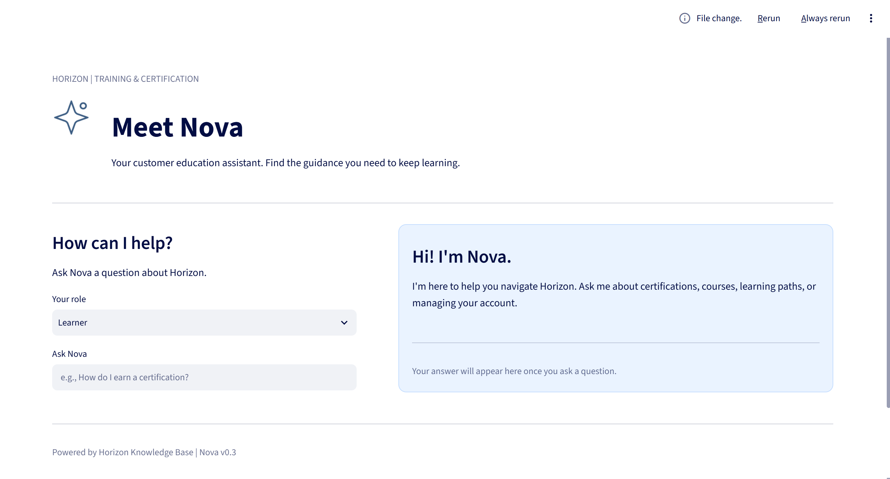

# Project Horizon

**Building Nova: A Customer Education Assistant**

Project Horizon is a hands-on Python and AI learning project focused on building Nova, a customer education assistant for Horizon Training & Certification, a fictional SaaS learning platform.

The goal is to explore how AI, knowledge management, and learning technology can work together to deliver scalable, accessible customer education.

## Meet Nova



Nova helps users find relevant guidance about Horizon's training and certification platform.

### Current Features
- **Knowledge base:** Structured articles covering learning paths, certifications, enrollment, analytics, and user management.
- **Question recognition:** Keyword-based topic matching that recognizes common variations in customer questions.
- **Role-based access:** Restricts administrator-only articles based on the selected user role.
- **Interactive interface:** A branded web application built with Streamlit.
- **Automated testing:** Six pytest tests covering topic recognition and article access permissions.

**Current development stage:** Nova uses rule-based question matching. AI-powered retrieval and response generation are planned future enhancements.

## Technology

- Python
- Streamlit
- pytest
- Git and GitHub

## Getting Started

1. Clone the repository.
2. Install the required Python dependencies (`streamlit` and `pytest`).
3. Run the application:

```bash
python -m streamlit run app.py
```

4. Open the local address provided by Streamlit.

To run the automated tests:

```bash
python -m pytest test_nova.py -v
```

## Development Roadmap

- [x] Build a structured knowledge base
- [x] Implement keyword-based question recognition
- [x] Add role-based article permissions
- [x] Build a branded Streamlit interface
- [x] Create automated tests
- [x] Establish Git version control
- [ ] Improve question matching and handling of ambiguous queries
- [ ] Implement AI-powered retrieval with source citations
- [ ] Evaluate answer accuracy and reliability
- [ ] Document findings in a portfolio case study

## Why I'm Building This

My background is in Customer Education, instructional design, and learning systems management. I've spent years developing scalable education programs, certification experiences, and the infrastructure that supports them.

Project Horizon is an opportunity to combine that experience with hands-on software development and AI exploration.

Rather than simply experimenting with AI tools, I'm learning how to build, test, and evaluate an application that addresses a real customer education challenge: helping users find trustworthy information when they need it.

---

*Project Horizon is an independent learning and portfolio project. Horizon Training & Certification is a fictional platform.*